# Liquidity Risk Optimizer (LRO) Ecosystem

An event-driven educational and research simulation ecosystem modeling Indian banking operations, capital market exchange microstructure, and liquidity risk optimization with machine-learning-assisted decision support.

```mermaid
graph LR
    subgraph Frontend [JavaFX Desktop Interface - Prompts 01-08]
        FA[Bank Simulator]
        FB[Exchange Simulator]
        FC[Liquidity Risk Optimizer]
    end

    subgraph Backend [Java 25 Multi-Module Engine - Prompts 11-30]
        B1[lro-common]
        B2[lro-persistence]
        B3[lro-bank-services]
        B4[lro-exchange-services]
        B5[lro-messaging]
        B6[lro-analytics]
        B7[lro-ml-adapter]
        B8[lro-orchestration]
        B9[lro-app]
    end

    subgraph ML [Python Microservice - Prompts 09-10]
        M1[Model 1: Momentum]
        M2[Model 2: Slippage]
    end

    Frontend <-->|STOMP & In-Process DTOs| Backend
    Backend <-->|HTTP REST & Local Fallbacks| ML
```



---

## 1. Directory Structure & Layout Boundaries
Per project requirements, the codebase is cleanly partitioned into three dedicated directories:

- **`frontend/` (Prompts 01–08)**:
  - Java 25 + JavaFX 23.0.1 desktop application (`lro-frontend`).
  - High-contrast slate financial theme (`style.css`), Indian numbering formatter (`₹ Lakhs/Crores`), modal financial glossary, and interactive views for Bank, Exchange, and LRO.
- **`model/` (Prompts 09–10)**:
  - Zero-dependency Python standard library HTTP inference microservice (`inference_server.py`) running on `http://127.0.0.1:8082`.
  - Machine learning metadata schemas, units, horizons, and training provenance in `model_metadata.json`.
- **`backend/` (Prompts 11–30)**:
  - Multi-module Maven reactor (`lro-backend-parent`) with 9 specialized submodules.
  - Multi-schema Flyway database migrations (`bank_large`, `bank_medium`, `bank_small`, `bank_distressed`, `exchange`, `lro`).
  - Double-entry ledger balancing, loan amortization, duration-weighted treasury ladders, continuous double-auction matching engine, STOMP event broker, mark-to-market lot valuation, Maker/Checker dual-approval workflows, macro crash stress testing, 7-day quote retention pruning, and historical OHLCV ingestion controls.

---

## 2. Key Architecture & Financial Invariants

1. **Double-Entry Ledger Balancing**:
   - Every banking transaction strictly enforces $\sum \text{Debits} = \sum \text{Credits}$. Unbalanced entries throw a `ValidationException` and are rejected prior to persistence.
2. **Monetary Precision**:
   - Zero floating-point rounding errors. All monetary arithmetic uses `Money` backed by `BigDecimal` with strict 2-decimal scale and Banker's rounding (`RoundingMode.HALF_EVEN`).
3. **Continuous Double Auction**:
   - Price-Time priority matching engine with Level-2 5-depth order books, partial fills, and sub-millisecond execution latency (>37,500 orders/sec).
4. **Resilient Event Messaging**:
   - STOMP-compatible topic publish/subscribe broker with outbox queue and idempotency deduplication by unique UUID `eventId`.
5. **Fail-Safe ML Integration**:
   - Java adapters connect to Python XGBoost microservices with timeout guards and immediate graceful fallback to deterministic financial formulations (Square-Root Law for slippage).
6. **Maker/Checker Dual Approval**:
   - No autonomous trading or balance transfers. All treasury recommendations require dual authorization (`MAKER` analyst $\rightarrow$ `CHECKER` supervisor $\rightarrow$ Operator execution).

---

## 3. Quick Start & Execution Guide

### Prerequisites
- Windows 11 or Fedora Linux
- OpenJDK 25 LTS
- Apache Maven 3.9+
- Python 3.10+

### Option A: Complete Ecosystem (One-Click Launch)
```powershell
# Windows PowerShell
.\backend\scripts\run-ecosystem.ps1

# Fedora Linux
bash ./backend/scripts/run-ecosystem.sh
```

### Option B: Running Individual Subsystems

#### 1. Launch ML Inference Microservice
```powershell
python "D:\Liquidity Optimizer\model\inference_server.py"
```
Verify health by visiting `http://127.0.0.1:8082/health` in your browser.

#### 2. Run Backend Reactor Test Suite & Initialization
```powershell
# Build and run all 42 automated tests across the 9 modules
mvn -f "D:\Liquidity Optimizer\backend\pom.xml" clean test

# Launch backend foundation
mvn -f "D:\Liquidity Optimizer\backend\lro-app\pom.xml" exec:java -Dexec.mainClass="com.lro.app.BackendLauncher"
```

#### 3. Launch Frontend JavaFX Desktop Application
```powershell
cd "D:\Liquidity Optimizer\frontend"
mvn clean javafx:run
```

---

## 4. Documentation Index
Comprehensive architectural, regulatory, and technical documentation is located in `backend/docs/`:
- [System Architecture](backend/docs/ARCHITECTURE.md)
- [Database Data Dictionary](backend/docs/DATA_DICTIONARY.md)
- [Service Contracts & STOMP Catalogue](backend/docs/SERVICE_CONTRACTS.md)
- [Regulatory Caveats & Basel III Review](backend/docs/REGULATORY_CAVEATS.md)
- [Assumptions & Plain Language Glossary](backend/docs/ASSUMPTIONS.md)
- [Model 1 Card: Equity Momentum](backend/docs/MODEL_CARD_MODEL1.md)
- [Model 2 Card: Execution Cost & Slippage](backend/docs/MODEL_CARD_MODEL2.md)
- [Release Handover & Verification Matrix](backend/docs/RELEASE_HANDOVER.md)

---

## 5. Educational Simulation Disclaimer
> [!NOTE]
> All institutions, customers, accounts, loan balances, transactions, and exchange orders generated in this software are entirely **fictional and synthetic**. This system is intended solely for academic research and simulation purposes and contains no connection to real-money banking systems, payment rails, or licensed financial exchanges.
